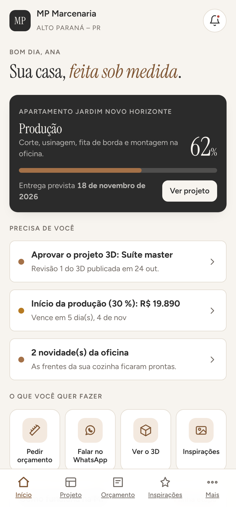
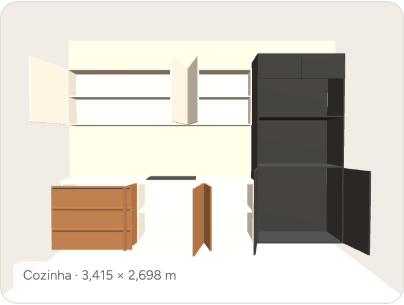
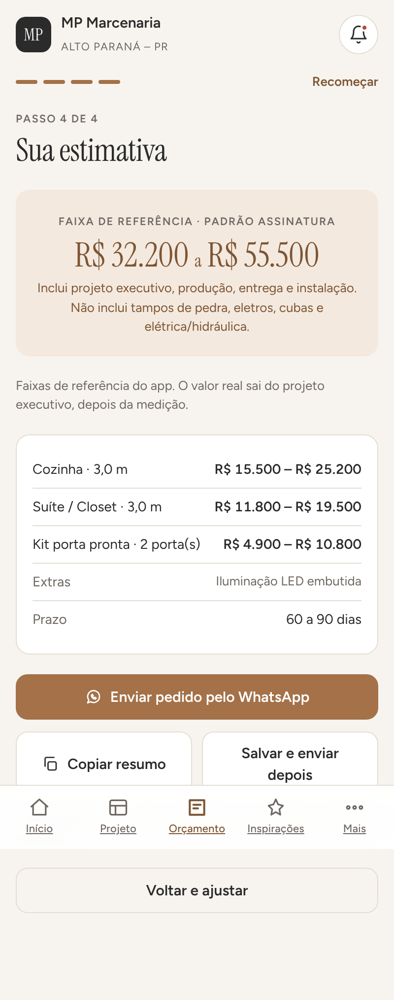
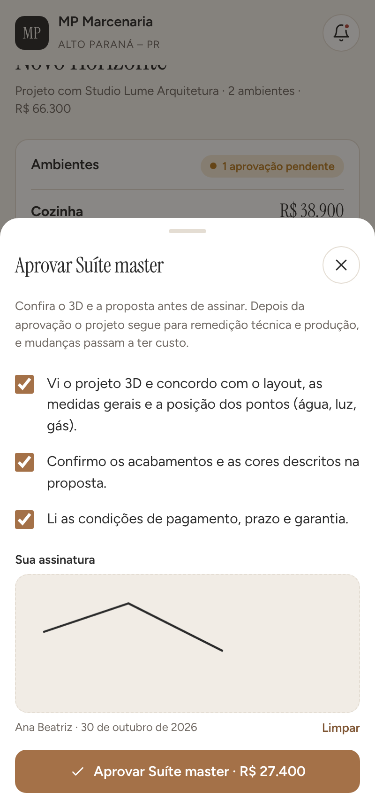

# MP Marcenaria — app do cliente

Aplicativo web instalável (PWA) para quem contrata móveis planejados, esquadrias
e kit porta pronta com a MP Marcenaria. Foi desenhado do lado do cliente: cada
tela responde a uma pergunta que o cliente faz durante a obra.

| Pergunta do cliente | Tela | O que o app faz |
| --- | --- | --- |
| "Quanto custa, mais ou menos?" | **Orçamento** | Assistente em 4 passos: ambientes, medidas aproximadas, padrão de acabamento e extras, fotos e referências. Mostra uma faixa de referência e envia o pedido já formatado pelo WhatsApp. |
| "Como está o meu projeto?" | **Projeto** | Linha do tempo das 9 etapas reais da MP, progresso, previsão de entrega e fotos "direto da oficina". |
| "É isso mesmo que vou receber?" | **Projeto › 3D** | Modelo 3D volumétrico (three.js) montado por peças, com portas e gavetas que abrem. Sem internet, cai para uma vista frontal desenhada em canvas. |
| "Como eu aprovo?" | **Aprovar** | Checklist do que foi conferido + assinatura digital na tela. A aprovação entra no histórico e gera notificação. |
| "Quanto falta pagar?" | **Pagamentos** | Parcelas com vencimento, copiar chave Pix, enviar comprovante, falar com a MP para renegociar. |
| "Quero algo parecido com aquilo" | **Inspirações** | Galeria por ambiente, favoritos, catálogo de acabamentos. "Quero algo assim" já abre o orçamento com o ambiente marcado. |
| "Deu um problema depois da entrega" | **Mais › Assistência** | Formulário curto que vira mensagem de assistência técnica com projeto e ambiente preenchidos. |
| "Como cuidar dos móveis?" | **Mais › Garantia** | Garantia de 5 anos explicada e 6 cuidados práticos com MDF. |
| "Quero indicar" | **Mais › Indique** | Código de indicação do cliente com mensagem pronta para compartilhar. |

Há também uma **área do marceneiro** (PIN) dentro do próprio app: muda a etapa e
o progresso, marca parcelas pagas, publica atualizações da oficina e ajusta as
faixas de referência. O que o marceneiro muda, o cliente vê na hora.

## Telas

| Início | Projeto 3D (portas abertas) | Estimativa | Aprovação assinada |
| --- | --- | --- | --- |
|  |  |  |  |

## Rodar

Não há build nem dependências. `src/` é a fonte; `dist/` é a PWA pronta.

```bash
./build.sh
python3 -m http.server 8080 --directory dist
```

Abra `http://localhost:8080`. No celular, "Adicionar à tela inicial" instala o
app; depois da primeira visita ele abre sem internet (service worker).

Para publicar: envie o conteúdo de `dist/` para qualquer hospedagem estática
(Vercel, Netlify, Cloudflare Pages, GitHub Pages). Precisa de HTTPS para o
service worker e para a instalação.

## Personalizar

Tudo que é da marcenaria está em `src/config.js`:

- **empresa**: nome, cidade, WhatsApp (formato `55DDDNÚMERO`), Instagram, chave Pix, CNPJ, garantia.
- **pinOficina**: PIN da área do marceneiro. Troque antes de publicar.
- **referencia / padroes / extras**: faixas de R$ por metro linear (ou por porta), fatores por padrão e extras. `precosConfigurados: true` remove o aviso de "faixa de referência".
- **etapas**: as etapas do processo, na linguagem do cliente.
- **acabamentos / inspiracoes**: catálogo e galeria. Troque as elevações desenhadas por fotos reais quando tiver (campo `foto`).
- **demo**: cliente, projeto e projeto 3D de exemplo. Em produção, esses dados vêm do backend (ver `docs/VISAO-DE-PRODUTO.md`).

Depois de editar, rode `./build.sh` de novo.

## Estrutura

```
src/
  page.html       esqueleto da página (também é o que se publica como Artifact)
  styles.css      design system: tokens de cor (claro/escuro), tipografia, componentes
  app.js          telas, roteamento por hash, estado em localStorage, 3D, assinatura
  config.js       tudo que a marcenaria personaliza
  sw.js           cache offline
  manifest.webmanifest, icon.svg, icon-192.png, icon-512.png
build.sh          monta dist/
dist/             PWA pronta para hospedar
docs/             visão de produto, modelo de negócio e roadmap
```

## Limites desta versão

- Os dados do cliente e do projeto são de demonstração e ficam no aparelho (localStorage). A versão com login e vários clientes precisa do backend descrito em `docs/VISAO-DE-PRODUTO.md`.
- As faixas de preço em `config.js` são valores de referência para o app funcionar; a MP precisa revisá-las antes de publicar. O valor real de um projeto sempre sai do projeto executivo.
- O 3D é volumétrico (cores e proporções reais), não fotorrealista.
- Os botões de WhatsApp abrem o aplicativo com a mensagem pronta; o envio é do cliente.
